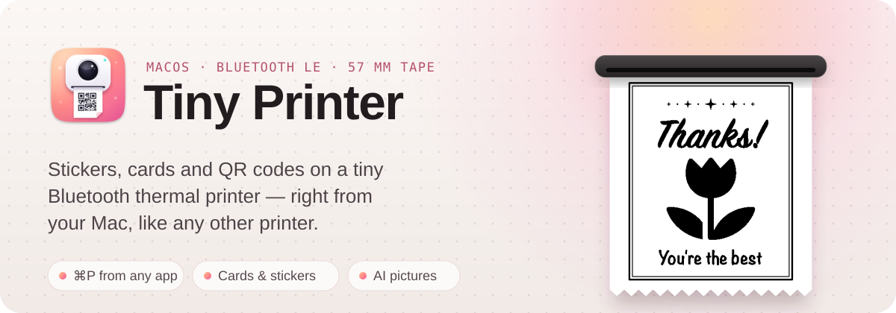
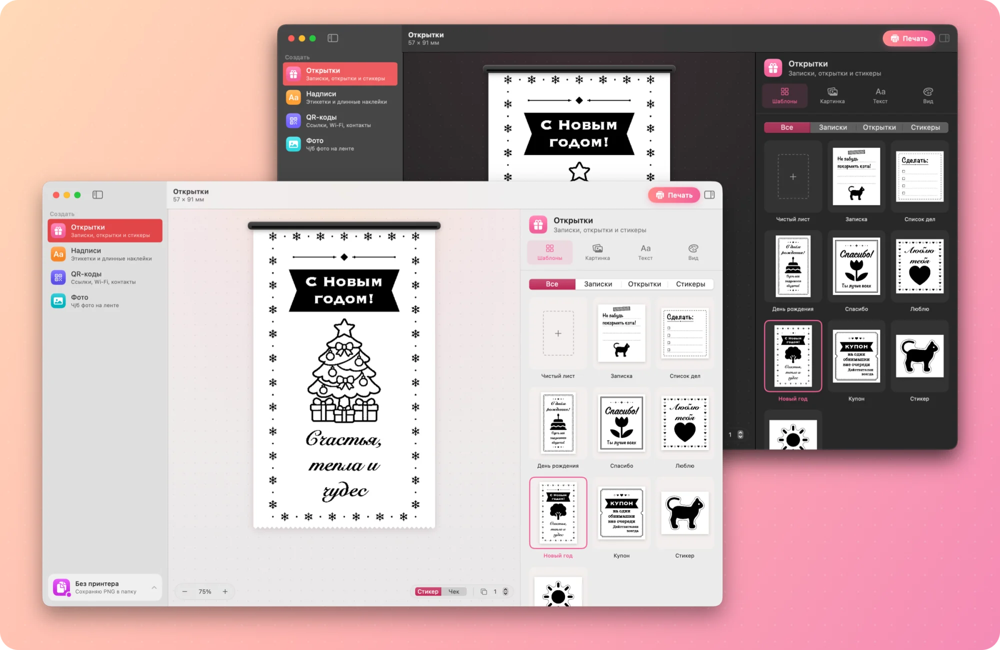
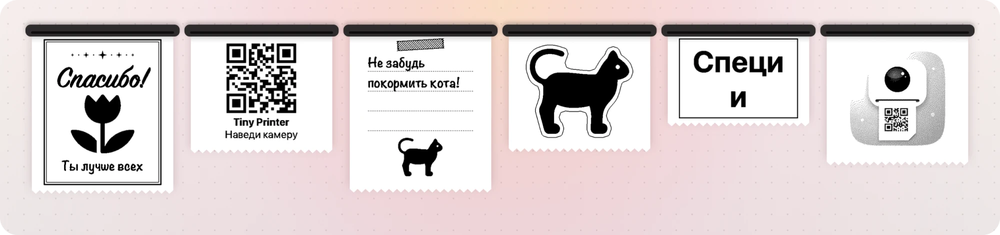
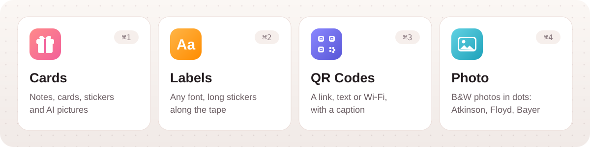

<p align="center">
  
</p>

<p align="center">
  <b>English</b> · <a href="README.ru.md">Русский</a>
</p>

<p align="center">
  
  
  
  
  
  
  
</p>

<p align="center">
  <a href="#features">Features</a> ·
  <a href="#install">Install</a> ·
  <a href="#how-it-works">How it works</a> ·
  <a href="#cli">CLI</a> ·
  <a href="#development">Development</a>
</p>

<p align="center">
  
</p>

Cheap 57 mm Bluetooth LE thermal printers (HOMIN, the “cat printers” and their relatives) only print from their own phone apps. **Tiny Printer** turns one into a regular Mac printer: lay out a sticker in a window with a live preview of the tape, or print from ⌘P in any app, from the menu bar or from the terminal.

## Real prints

<p align="center">
  
</p>

<sub>Not mockups: this is the renderer’s output, `tinyprint … --preview out.png`, 1-bit at 203 dpi, exactly what goes to the printer.</sub>

## Features

<p align="center">
  
</p>

- 🎁 **Cards**: notes, little greeting cards and stickers. 9 templates with live previews (taped note, to-do list, birthday, thanks, love, New Year, coupon, stickers), 13 frames, decorations, calligraphy fonts, a cut-out outline for stickers, several copies in a row.
- ✨ **AI pictures**: describe a picture in words (“a kitten asleep on a book”) or redraw your photo as a sticker. Drawn by OpenAI (GPT Image) or Google (Gemini / Imagen) with your own API key, in styles that suit thermal paper: outline, woodcut, silhouette, pixel art… Every picture shows its estimated cost, and Settings keep a running total.
- 🏷️ **Labels**: stickers in any font, including long labels that run along the tape for folder spines and cables.
- 🔳 **QR codes**: a link, text or Wi‑Fi network, with a caption on top or to the side.
- 🖼️ **Photos**: black-and-white with dithering (Atkinson, Floyd–Steinberg, Bayer), brightness, contrast, gamma and sharpness.
- 🖨️ **“Tiny Printer” system printer**: shows up in ⌘P of Safari, Preview, Pages and any other app. Paper sizes 57×20…150 mm plus custom.
- 📋 **Print the clipboard** (⇧⌘P or the menu bar): a link becomes a QR code, text becomes a label, an image becomes a photo.
- 🌍 **Six languages**: English, Русский, Deutsch, Español, Français and 简体中文. The app follows the macOS language; pick one per app in System Settings → General → Language & Region.
- 🌗 **Light and dark mode**: follows the system or set it by hand in **View → Appearance**.
- 🧪 **No printer needed**: jobs can be saved as PNG files, handy for checking layouts without hardware.

### The window

| Where | What’s there |
|---|---|
| Left | Modes (⌘1…⌘4) and the printer card: status, battery, connection, test print |
| Middle | The tape comes out of the printer slot; zoom “Fit” or 50…300 %, drop pictures right onto the tape; paper (sticker / receipt) and number of copies at the bottom |
| Right | Layout settings (⌃⌘I to hide). Cards have four tabs: Templates, Picture, Text, Design |
| Top | **Print** (⌘P) |

## Install

You need macOS 14+ and Xcode or the Command Line Tools (`xcode-select --install`).

```bash
git clone https://github.com/RemDee13/Tiny-Printer.git && cd Tiny-Printer
scripts/build-app.sh --install     # → /Applications/TinyPrinter.app and ~/.local/bin/tinyprint
```

Then open **Settings (⌘,)**:

1. **Printer → Print to:** “Bluetooth printer”.
2. Turn the printer on, **disconnect it from your phone** (a BLE printer keeps a single connection) and click **Connect**, here or on the printer card at the bottom left.
3. **General → Printing from Other Apps → Add**: macOS gets a “Tiny Printer” printer (no password, this Mac only).
4. For AI pictures: **AI** → paste your OpenAI or Google key.

Settings tabs: **Printer** (connection, nearby devices, protocol), **General** (appearance, paper, density, system printer, documents), **AI** (key, model, spending), **Log** (jobs and the Bluetooth exchange).

## How it works

<p align="center">
  
</p>

```
Any app ⌘P → CUPS → ipp://localhost:8613 (ippeveprinter from macOS)
   → ipp-handler.sh → POST http://127.0.0.1:8614/print (PDF) → Tiny Printer.app
   → render at 203 dpi → 1 bit (threshold or dithering) → driver → Bluetooth LE
```

- macOS has no driver for BLE printers, so the app runs `ippeveprinter`, the IPP Everywhere emulator that ships with macOS, on `localhost` only and without announcing it on the network. CUPS hands it a PDF of the right size.
- Only the app holds the Bluetooth connection (it has its own macOS permission); the CLI and system printing talk to it through a local API on `127.0.0.1:8614`.
- If the app is closed, jobs wait in the macOS print queue.

### Protocols

Detected automatically from the device name, or, when the name says nothing, from the reply to a harmless status request (the paper doesn’t move). You can also pick the protocol by hand: **Printer → Protocol**.

| Family | Vendor app | GATT | Status |
|---|---|---|---|
| Cat printer `51 78` (GB0x, GT0x, MX0x, X6h, YT01…) | Tiny Print, iPrint | AE30 / AE01 / AE02 | bytes checked against captures |
| MXW01 / V5X `22 21` | Fun Print, iBleem | AE30 / AE01 / AE03 | implemented |
| Phomemo M02 / T02 | Phomemo | FF00 / FF02 | implemented |
| Luck Jingle `10 FF` | Luck Jingle | FF00 / FF02 | implemented |
| ESC/POS (18F0, ISSC, Gprinter; YHK) | various | — | implemented |

> [!WARNING]
> The drivers follow the sources of open projects (NaitLee/Cat-Printer, rbaron/catprinter, TiMini-Print, MXW01-catprinter, phomemo-tools and others) and **have not been tested on a real printer yet**. First run with a device: Settings → Printer → Connect → Test Print. If something is off, use Settings → Log → “Copy” (it has the GATT profile and the exchange).

### Privacy

- API keys live only in the macOS Keychain: not in preferences, not in files, not in this repository.
- AI requests go straight to OpenAI or Google; the app makes no other network requests.
- Both local services (IPP and the API) listen only on `127.0.0.1` / `::1`, so nothing on the network can reach them.
- AI pictures and the spending log are kept in `~/Library/Application Support/TinyPrinter/`.

## CLI

```bash
tinyprint status
tinyprint log                                      # log and GATT profile of the connected printer
tinyprint text "Spices" --along                    # a label along the tape, full width
tinyprint text "Top shelf\ncereal" --size 20
tinyprint qr "https://example.com" --caption "Website" --side --length 30
tinyprint image photo.jpg --dither atkinson --rotate
tinyprint file doc.pdf --mode text --trim
tinyprint card --preset birthday --image cake.png  # a card from a template; tinyprint card --list shows them all
tinyprint card --preset sticker --image cat.png --repeat 3
```

Add `--preview out.png` to any command to save the picture instead of printing; it works without the app running. The CLI speaks the same language as the app.

## Development

```bash
swift build && swift test          # 30 tests: protocols, QR, PDF, cards and sticker outline, OpenAI/Gemini requests, translations
scripts/build-app.sh               # build/TinyPrinter.app (Apple Development signing, so macOS remembers the Bluetooth permission)
scripts/check-localization.sh      # UI strings in the code that have no translation yet
swift scripts/make-icon.swift Resources/AppIcon-1024.png   # the icon (then iconutil → Resources/AppIcon.icns)
```

| Folder | What’s inside |
|---|---|
| `Sources/TinyPrinterKit` | Rendering, dithering, cards, AI client, drivers, BLE transport |
| `Sources/TinyPrinterApp` | The SwiftUI app, local API, system printer |
| `Sources/tinyprint` | CLI |
| `Resources/Localization` | Translations: `<lang>.lproj/Localizable.strings`, keyed by the Russian source strings |
| `Tests/TinyPrinterKitTests` | Tests for protocols, rendering, cards and translations |
| `assets/readme` | Pictures for this README |

To remove the system printer: **Settings → General → “Remove”** (or `lpadmin -x Tiny_Printer`).
