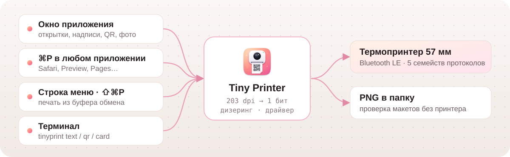

<p align="center">
  
</p>

<p align="center">
  
  
  
  
  
  
</p>

<p align="center">
  <a href="#что-умеет">Что умеет</a> ·
  <a href="#установка">Установка</a> ·
  <a href="#как-это-устроено">Как устроено</a> ·
  <a href="#cli">CLI</a> ·
  <a href="#разработка">Разработка</a>
</p>

<p align="center">
  
</p>

Дешёвые BLE-термопринтеры на 57 мм (HOMIN, «котики» и их родня) умеют печатать только из своих приложений для телефона. **Tiny Printer** делает из такого принтера обычный принтер для Mac: макет собирается в окне с живым превью ленты, а печатать можно из ⌘P любой программы, из строки меню или из терминала.

## Что печатает

<p align="center">
  
</p>

<sub>Это не макеты, а настоящий вывод рендера: `tinyprint … --preview out.png`, 1 бит, 203 dpi — ровно то, что уйдёт на принтер.</sub>

## Что умеет

<p align="center">
  
</p>

- 🎁 **Открытки** — записки, маленькие открытки и стикеры. 9 шаблонов с живыми превью (записка со «скотчем», список дел, день рождения, спасибо, люблю, Новый год, купон, стикеры), 13 рамок, украшения, каллиграфические шрифты с кириллицей, контур для вырезания стикера, несколько штук подряд.
- ✨ **AI-картинки** — опишите словами («котик спит на книжке») или перерисуйте своё фото в стикер. Рисует OpenAI (GPT Image) или Google (Gemini / Imagen) по вашему ключу API, стиль подобран под термопечать: контур, гравюра, силуэт, пиксель-арт… После каждой картинки видна её примерная цена, в настройках — сумма за всё время.
- 🏷️ **Надписи** — наклейки любым шрифтом, в том числе длинные надписи вдоль ленты для корешков папок и проводов.
- 🔳 **QR-коды** — ссылка, текст или Wi‑Fi, подпись сверху или сбоку.
- 🖼️ **Фото** — ч/б с растрированием (Аткинсон, Флойд–Стейнберг, Байер), яркость, контраст, гамма, резкость.
- 🖨️ **Системный принтер «Tiny Printer»** — виден в ⌘P браузера, Preview, Pages и любых других приложений. Размеры 57×20…150 мм и свой.
- 📋 **Печать из буфера** (⇧⌘P или строка меню): ссылка → QR, текст → наклейка, картинка → фото.
- 🌗 **Светлая и тёмная тема** — как в системе или вручную: **Вид → Оформление**.
- 🧪 **Без принтера** — задания сохраняются как PNG, удобно проверять макеты без железа.

### Окно

| Где | Что там |
|---|---|
| Слева | Режимы (⌘1…⌘4) и карточка принтера: состояние, заряд, подключение, тестовая печать |
| В центре | Лента выходит из щели принтера; масштаб «Вписать» или 50…300 %, картинки можно перетащить прямо на ленту; внизу — бумага (стикер / чек) и число копий |
| Справа | Настройки макета (⌃⌘I — скрыть). У открыток четыре вкладки: Шаблоны, Картинка, Текст, Вид |
| Наверху | **Печать** (⌘P) |

## Установка

Нужны macOS 14+ и Xcode или Command Line Tools (`xcode-select --install`).

```bash
gh repo clone RemDee13/Tiny-Printer && cd Tiny-Printer
scripts/build-app.sh --install     # → /Applications/TinyPrinter.app и ~/.local/bin/tinyprint
```

Потом **Настройки (⌘,)**:

1. **Принтер → Куда печатать:** «Bluetooth-принтер».
2. Включить принтер, **отключить его от телефона** (BLE-принтер держит одно подключение) и нажать **Подключить** — здесь или в карточке принтера внизу слева.
3. **Основные → Печать из других приложений → Добавить** — в системе появится принтер «Tiny Printer» (без пароля, только для этого Mac).
4. Для AI-картинок: **AI** → вставить свой ключ OpenAI или Google.

Вкладки настроек: **Принтер** (подключение, устройства рядом, протокол), **Основные** (оформление, бумага, плотность, системный принтер, документы), **AI** (ключ, модель, расходы), **Журнал** (задания и обмен по Bluetooth).

## Как это устроено

<p align="center">
  
</p>

```
Любое приложение ⌘P → CUPS → ipp://localhost:8613 (ippeveprinter из macOS)
   → ipp-handler.sh → POST http://127.0.0.1:8614/print (PDF) → Tiny Printer.app
   → рендер 203 dpi → 1 бит (порог или дизеринг) → драйвер → Bluetooth LE
```

- Драйвера для BLE-принтеров в macOS нет, поэтому приложение запускает встроенный в macOS `ippeveprinter` (эмулятор IPP Everywhere) только на `localhost`, без анонса в сети. CUPS отдаёт ему PDF нужного размера.
- Bluetooth держит только приложение (у него своё разрешение macOS); CLI и системная печать ходят к нему через локальный API на `127.0.0.1:8614`.
- Если приложение закрыто, задания ждут в очереди macOS.

### Протоколы

Определяются автоматически по имени устройства, а если имя ничего не говорит — по ответу на безопасный запрос состояния (бумага не двигается). Протокол можно задать вручную: **Принтер → Протокол**.

| Семейство | Приложение производителя | GATT | Статус |
|---|---|---|---|
| Cat printer `51 78` (GB0x, GT0x, MX0x, X6h, YT01…) | Tiny Print, iPrint | AE30 / AE01 / AE02 | байты сверены с захватами |
| MXW01 / V5X `22 21` | Fun Print, iBleem | AE30 / AE01 / AE03 | реализован |
| Phomemo M02 / T02 | Phomemo | FF00 / FF02 | реализован |
| Luck Jingle `10 FF` | Luck Jingle | FF00 / FF02 | реализован |
| ESC/POS (18F0, ISSC, Gprinter; YHK) | разные | — | реализован |

> [!WARNING]
> Драйверы написаны по исходникам открытых проектов (NaitLee/Cat-Printer, rbaron/catprinter, TiMini-Print, MXW01-catprinter, phomemo-tools и др.) и **ещё не проверены на живом принтере**. Первый запуск с устройством: Настройки → Принтер → Подключить → Тестовая печать. Если что-то не так — Настройки → Журнал → «Скопировать» (там GATT-профиль и обмен).

### Приватность

- Ключи API хранятся только в Связке ключей macOS — не в настройках, не в файлах и не в этом репозитории.
- Запросы к AI идут напрямую в OpenAI или Google; других сетевых запросов приложение не делает.
- Обе локальные службы (IPP и API) слушают только `127.0.0.1` / `::1` — из сети к ним не подключиться.
- Картинки AI и журнал расходов лежат в `~/Library/Application Support/TinyPrinter/`.

## CLI

```bash
tinyprint status
tinyprint log                                      # журнал и GATT-профиль подключённого принтера
tinyprint text "Специи" --along                    # надпись вдоль ленты на всю ширину
tinyprint text "Верхняя полка\nкрупы" --size 20
tinyprint qr "https://example.com" --caption "Сайт" --side --length 30
tinyprint image photo.jpg --dither atkinson --rotate
tinyprint file doc.pdf --mode text --trim
tinyprint card --preset birthday --image torte.png  # открытка по шаблону; tinyprint card --list — все шаблоны
tinyprint card --preset sticker --image cat.png --repeat 3
```

Любая команда с `--preview out.png` сохраняет картинку вместо печати и работает без запущенного приложения.

## Разработка

```bash
swift build && swift test          # 29 тестов: протоколы, QR, PDF, открытки и контур стикера, запросы к OpenAI/Gemini
scripts/build-app.sh               # build/TinyPrinter.app (подпись Apple Development, чтобы macOS помнила доступ к Bluetooth)
swift scripts/make-icon.swift Resources/AppIcon-1024.png   # иконка (потом iconutil → Resources/AppIcon.icns)
```

| Папка | Что внутри |
|---|---|
| `Sources/TinyPrinterKit` | Рендер, дизеринг, открытки, AI-клиент, драйверы, BLE-транспорт |
| `Sources/TinyPrinterApp` | SwiftUI-приложение, локальный API, системный принтер |
| `Sources/tinyprint` | CLI |
| `Tests/TinyPrinterKitTests` | Тесты протоколов, рендера и открыток |
| `assets/readme` | Картинки этого README |

Удалить системный принтер: **Настройки → Основные → «Убрать»** (или `lpadmin -x Tiny_Printer`).
